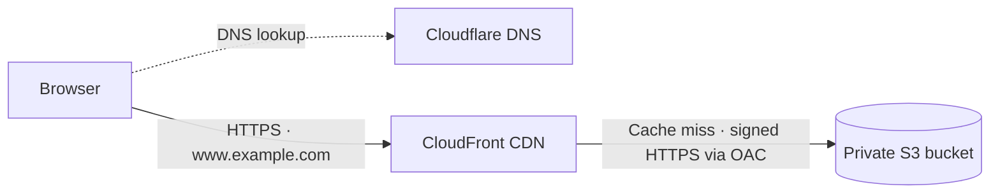
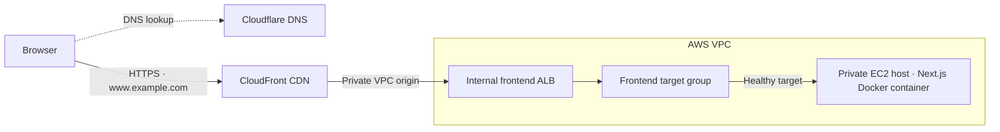
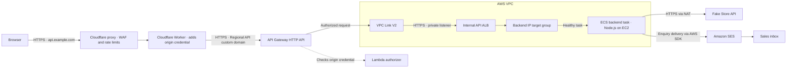

# Proposed network architecture

The catalogue has two public hostnames. `www.example.com` serves the frontend through CloudFront. `api.example.com` serves the backend through Cloudflare and API Gateway. The frontend hosting options share the same API. The baseline uses Cloudflare DNS for the frontend and Cloudflare's HTTP proxy for the API. These are deployment designs for the current catalogue.

| Frontend option | Best fit for this catalogue |
| --- | --- |
| Private S3 bucket and CloudFront | Use after the app can export every required page or provide client-side routing for dynamic category and product URLs. |
| Docker on EC2 behind an Application Load Balancer | Use for the existing Next.js routes and image optimization. The current application needs a Next.js runtime for those features. |

## 1. Static frontend on S3

Cloudflare is the authoritative DNS provider for `www.example.com`. The record is **DNS only**, so CloudFront handles browser HTTPS and caching. A CloudFront cache hit ends the asset request at the edge. On a miss, CloudFront signs an HTTPS request to the private S3 bucket using Origin Access Control (OAC). S3 Block Public Access stays enabled, and the bucket policy grants reads to the named CloudFront distribution. Use the regular S3 bucket endpoint for OAC. [Cloudflare proxy status](https://developers.cloudflare.com/dns/proxy-status/) · [AWS S3 origin access](https://docs.aws.amazon.com/AmazonCloudFront/latest/DeveloperGuide/private-content-restricting-access-to-s3.html)



The build publishes HTML, JavaScript, and CSS to S3. To use this option, replace the current Next.js rewrites with calls to the deployed API hostname, and adapt the dynamic routes and image handling for static export. Test direct navigation and refresh on category and product URLs. [Next.js static exports](https://nextjs.org/docs/app/guides/static-exports)

## 2. Docker frontend on EC2

The browser connects to CloudFront after resolving `www.example.com` through Cloudflare DNS. CloudFront forwards dynamic page requests through a VPC origin to an **internal Application Load Balancer (ALB)**. The ALB listener uses its frontend target group to select a healthy EC2 host running the Next.js Docker container. Serve fingerprinted assets with caching and leave dynamic page responses uncached by default. [CloudFront VPC origins](https://docs.aws.amazon.com/AmazonCloudFront/latest/DeveloperGuide/private-content-vpc-origins.html)



Use HTTPS from CloudFront to the ALB with an origin hostname and certificate that match. The ALB security group allows ingress from the CloudFront VPC origin service security group. The EC2 security group allows the container port from the frontend ALB security group. In this design, the ALB terminates TLS and forwards HTTP to the container over the restricted private network. Use HTTPS targets if the deployment requires encryption on that last hop. [CloudFront VPC origin access](https://docs.aws.amazon.com/AmazonCloudFront/latest/DeveloperGuide/private-content-vpc-origins.html)

## 3. API on Amazon ECS with EC2 capacity

Both frontend options use the same browser API flow. For example, the browser calls `GET https://api.example.com/products/featured` or `POST https://api.example.com/enquiries`. The deployed API client uses the public API base URL, while local development can keep using the existing Next.js rewrite. Configure API Gateway CORS for the exact frontend origin and allow the required methods and headers, including `POST` and `Content-Type`. API Gateway can answer browser preflight requests. [API Gateway HTTP API CORS](https://docs.aws.amazon.com/apigateway/latest/developerguide/http-api-cors.html)



### How a request passes the checks

1. **Cloudflare edge.** The browser opens HTTPS to the proxied `api.example.com` hostname. Configure Cloudflare WAF rules and rate limits, with a tighter limit on `POST /enquiries`. An allowed request is forwarded without edge caching. Cloudflare uses HTTPS with certificate verification for the AWS origin. [Cloudflare proxy status](https://developers.cloudflare.com/dns/proxy-status/) · [Cloudflare Full (strict)](https://developers.cloudflare.com/ssl/origin-configuration/ssl-modes/full-strict/)
2. **API Gateway origin check.** Disable the default `execute-api` endpoint. The Worker overwrites any inbound origin-credential header with a secret stored in a Worker binding and forwards to a separate Regional API Gateway custom domain, such as `api-origin.example.com`. A Lambda authorizer rejects missing or invalid credentials on application routes. This covers a direct attempt to call the AWS custom domain and keeps browser users anonymous. Keep the secret out of client code, responses, and logs. CORS controls browser access across origins. The authorizer controls which requests reach the private application routes. [Cloudflare Worker secrets](https://developers.cloudflare.com/workers/configuration/secrets/) · [Regional custom domain](https://docs.aws.amazon.com/apigateway/latest/developerguide/apigateway-regional-api-custom-domain-create.html) · [Disable default endpoint](https://docs.aws.amazon.com/apigateway/latest/developerguide/http-api-disable-default-endpoint.html) · [Lambda authorizer](https://docs.aws.amazon.com/apigateway/latest/developerguide/http-api-lambda-authorizer.html)
3. **Private network.** API Gateway applies route throttling and forwards authorized requests over VPC Link V2. Specify the ALB certificate name in the integration TLS settings. Restrict the ALB listener to the VPC Link security group and the task port to the API ALB security group. The ALB sends requests to healthy ECS task IPs. When using a named API stage, map the integration path to `$request.path` so the backend receives its existing route paths. [HTTP API private integrations](https://docs.aws.amazon.com/apigateway/latest/developerguide/http-api-develop-integrations-private.html) · [ALB for ECS](https://docs.aws.amazon.com/AmazonECS/latest/developerguide/alb.html)
4. **Application.** Node validates the enquiry body and checks that the product exists. Catalogue lookups call Fake Store from the backend through controlled outbound internet access. In AWS, replace the local file email adapter with an SES adapter and grant the ECS task role the required send permission. The app returns `201` once SES accepts the email for delivery. The response travels back through the ALB, API Gateway, and Cloudflare, then the browser displays **Thank you**. [Sending email with SES](https://docs.aws.amazon.com/ses/latest/dg/send-email-api.html)

The first enquiry from a browser can look like this:

```text
OPTIONS /enquiries → Cloudflare → API Gateway → CORS response
POST /enquiries    → Cloudflare checks → API Gateway authorizer
                  → VPC Link → ALB → healthy ECS task → SES accepts
201 Accepted      ← Cloudflare ← API Gateway ← ALB ← ECS task
```

### Deployment details

- Make the frontend and backend processes listen on their container interfaces and expose the ports expected by the target groups. The local backend currently binds to loopback. Add a lightweight health endpoint for the API target group that can answer without calling Fake Store.
- Put ALBs and compute targets in private subnets across two Availability Zones. ECS tasks use the `awsvpc` network mode and an IP target group. Private backend subnets need outbound access to the public Fake Store API, for example through a NAT gateway.
- ECS Service Auto Scaling changes the desired number of **backend tasks**. The ECS EC2 capacity provider's managed scaling changes the number of **EC2 hosts** in its Auto Scaling group. The group, capacity provider, and ECS scheduler manage capacity outside the HTTP request path. [ECS service auto scaling](https://docs.aws.amazon.com/AmazonECS/latest/developerguide/service-auto-scaling.html) · [ECS cluster auto scaling](https://docs.aws.amazon.com/AmazonECS/latest/developerguide/cluster-auto-scaling.html)

## What each component does

| Component | Role |
| --- | --- |
| Cloudflare DNS | Resolves the frontend hostname to CloudFront and routes the proxied API hostname through Cloudflare. |
| Cloudflare proxy and WAF | Terminates API browser TLS, evaluates configured web firewall rules, and rate-limits requests. |
| Cloudflare Workers | Runs edge code that forwards API traffic and adds the origin credential. |
| Amazon CloudFront | Serves frontend content at the edge, caches eligible assets, and connects to the configured frontend origin. |
| Amazon S3 | Stores the static build output. OAC and the bucket policy control CloudFront's origin access. |
| Elastic Load Balancing and ALB | Provides HTTP routing and health checks for the frontend or backend. Each deployment path uses its own ALB. |
| Target group | Defines registered targets, health checks, and forwarding ports for an ALB. Frontend targets are EC2 hosts. Backend targets are ECS task IPs. |
| Docker and Amazon EC2 | Docker packages the app processes. EC2 provides the virtual machines that run the containers. |
| Amazon API Gateway | Exposes HTTP API routes and handles custom domains, authorization, throttling, and CORS. |
| AWS Lambda authorizer | Verifies the Worker credential before API Gateway forwards an application request. |
| VPC Link V2 | Gives API Gateway a private connection to the internal API ALB. |
| Amazon ECS | Schedules backend tasks on the EC2 cluster, replaces failed tasks, and registers tasks with the backend target group. |
| EC2 Auto Scaling group | Adds or removes backend EC2 hosts as the ECS capacity provider requests capacity. |
| AWS Certificate Manager | Provides the certificates for CloudFront, the API Gateway Regional custom domain, and the ALB listeners where TLS is enabled. |
| Amazon SES | Accepts and delivers sales email from the proposed production adapter. |
